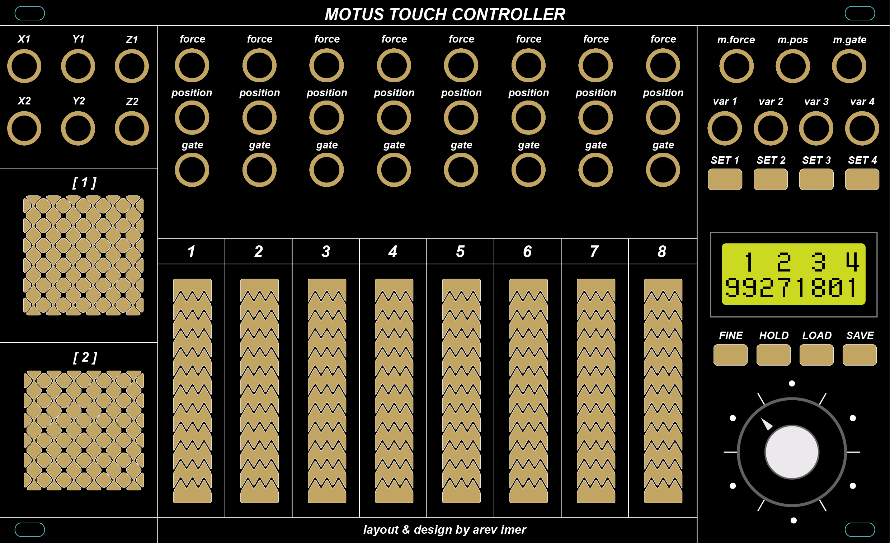

# Motus Touch Controller



Motus is a capacitive touch controller for modular synthesizers. It turns finger position and pressure into control voltages and gates: eight touch sliders, two XY pads, a master output that mixes the active sliders, and four preset voltages switched by the sliders.

## Controls and outputs

| Section | Outputs | What they do |
|---|---|---|
| Sliders 1–8 | `position`, `force`, `gate` | The slider's output (a voltage, a note or an LFO, see slider modes), pressure of the finger, gate while touched. The output and LEDs hold their value after release. |
| XY pads 1–2 | `X1` `Y1` `Z1`, `X2` `Y2` `Z2` | Finger position on the pad and its pressure (Z), or a Lorenz or Rössler attractor the finger pulls on (see XY pads). The pad LEDs glow around the finger, or follow the attractor. |
| Master | `m.pos`, `m.force`, `m.gate` | Average position output and pressure of all sliders that are touched, looping or running an LFO, so it stays in range; holds its value when none are. Gate while any slider gate is on, or the sequencer's step trigger while it runs. |
| Sequencer | `var 1`–`var 4` | The four rows of the step sequencer, see below. |

The display shows the touched slider or pad with its value (a voltage, note or LFO rate), the menu while it is open, or the sequencer state when idle.

### Buttons and menu

The eight touch buttons are labelled for what they do (relabelled with 6 mm tape strips, see `docs/labels/`; the original panel print is in brackets):

| Button | Tap | Double tap | Hold (0.5 s) |
|---|---|---|---|
| `A·PLAY` `B·OUT` `C·TIME` `D·SEQ` (`SET 1`–`SET 4`) | open that settings page; tap again, or in a step view or a row's settings, to close it | start or stop sequencer row A–D (the row on `var 1`–`var 4` above the button), from anywhere; whatever was open stays as it was | the step view of row A–D (see Sequencer); held there again: the row's settings |
| `EDIT` (`FINE`) | toggle fine steps for exact values (± on the display), until the menu closes | | with the encoder: change the value shown |
| `REC` (`HOLD`) | arm recording (see Recording) | | with a touch: record while held |
| `RUN` (`LOAD`) | start all rows, or stop them if any runs | | open the SYS settings; held again: close them |
| `PATCH` (`SAVE`) | `LOAD 2?`: turn to pick a slot or template, tap again to load | | `SAVE 2?`: turn to pick a slot, tap to save (the second line says `replace`, `empty` or `current`) |

The encoder scrolls through the settings of the page that is open; hold `EDIT` and turn to change a value. Touching a slider or pad selects what PLAY, OUT and TIME edit, and it keeps playing as usual. Holding the open page's button and turning chooses the slider without touching it (on PLAY, past slider 8 come the XY pads `P1` and `P2`). While a row button is held, a touch only selects and leaves the outputs unchanged; a button held while the encoder turns or a control is touched is a modifier, so letting go is neither a tap nor a hold. Settings close after 5 seconds without input (a row's settings back to its step view); a step view stays open until you tap a row button.

| Page | Settings |
|---|---|
| PLAY (`A`) | how the finger plays the touched slider: LFO off or on, then the settings of that mode (see Slider modes); for an XY pad its MODE, RATE and CHAOS (see XY pads) |
| OUT (`B`) | the slider's output: QUANT, ROOT, BASE, RANGE |
| TIME (`C`) | the slider's output processing in time: SLEW, SLANT, DELAY, LOOP, FREEZE (see TIME) |
| SEQ (`D`) | the sequencer: CLOCK, BPM, DIV, TOUCH |
| SYS (hold `RUN`) | the global settings (see System settings) |

In the `LOAD` prompt, four templates for a fresh start come after the slots (`INIT?`): faders (8 plain 0–8 V faders), lfos (8 sine LFOs with clock gates, their phases spread 45° apart), keys (8 quantized keyboards, C major over two octaves) and split (4 keys, 4 LFOs 90° apart). A template also clears the sequencer and its values, sets both pads to `xy`, starts every slider from the bottom (a fader at its BASE, LFOs from the start of their cycle), and stays unsaved until you save it. A row button, `EDIT`, or 5 s without input cancels either prompt; holding `PATCH` in the `LOAD` prompt switches to `SAVE`.

A slot holds a patch: every slider's and pad's settings, the sequencer's stage values and settings. The SYS settings are global and saved with every save. The idle screen shows whether the sequencer runs, with its tempo or clock slider (`RUN 120`, `RUN  #3`, `STOP 120`). While running, the second line has a tube per row A–D, one pixel row per step and as tall as the row's length, filled up to its current step (empty while that row is stopped); when stopped, it shows the current slot (`Slot 2`). A dot shows while recording and `*` while there are unsaved changes. The unit starts with the slot saved or loaded last and shows it for a second, as does a load. Recordings are not saved.

### System settings

Hold `RUN` to open them, and again to close them.

| Setting | Values |
|---|---|
| SMOOTH | 1 (light) to 10 (heavy): smoothing of slow finger movement; fast moves always stay fast |
| DEADBAND | 0–20: how much a resting finger can wobble without moving the output |
| PRESSURE | 50–200 %: how hard counts as a firm press, for force and Z |
| TOUCH | 50–200 %: touch sensitivity; higher reacts to lighter touches |
| BRIGHT | 10–100 %: LED brightness |
| TRIG LEN | 1–20 ms: trigger length |
| LOOP TRG | on or off: a gate held across a loop start drops briefly to retrigger |
| AUTOSAVE | off (default) or on: after 10 s without touching anything, changes are saved into the current slot. Not after loading a template, until you save or load a slot yourself |

### Sequencer

A step sequencer in the spirit of the Serge TKB: the 8 sliders are 8 stages, and every stage has four voltages, the rows A–D on `var 1`–`var 4`. On the screen, rows are A–D and sliders #1–#8. Every row starts and stops on its own (double tap its row button `A`–`D`; `RUN` starts or stops them all), and the running rows step together on the clock. While any row runs, `m.gate` sends a trigger on every step and the top LED of the current stage (of the first running row, or of the row being written) is lit.

**Step views:** hold `A`–`D` to open the step view of row A–D. The sliders' LEDs show the row's values, each where it lies in the row's range, and touching a slider stores its position, in the row's BASE, RANGE and QUANT, into the row at that stage; touches do not move the running sequence and leave the slider's own outputs (position, force, gate) and any loop unchanged. While the row is stopped, the encoder steps the stopped rows by hand, as on the idle screen, and the view shows the current step; while running, it browses the stages. Holding `EDIT` while turning edits the stage shown (semitones, 0.01 V with fine steps on). Holding the row's button while turning shifts the row's start and end together, wrapping past 8 (its SHIFT), and with `EDIT` held too it changes the row's length; meanwhile the stages inside the row's window light up fully, the playing one brightest, and the others go dark. Holding the row's button without turning opens the row's settings (below); holding another row's button switches to that row's view. Holding a slider and turning edits that slider's step; from then on the finger no longer writes during that touch. The current step has its top LED lit and shows at full brightness, the others are dimmed. While the row runs, the stage shown (picked with the encoder) keeps its top LED lit as well, and that LED dims while the step passes through it. The display shows the row and its direction over the shown stage's value (`A  fwd` over `C#2 2.08`; while writing, `#3 → A`), or the start or length while they are changed.

**Row settings** (hold the row's pad in its step view; hold it again to go back):

| Setting | Values |
|---|---|
| DIR | forward, backward, pendulum, random |
| SHIFT | 1–8: the stage the row starts on; it runs its length from there, past 8 back to 1 |
| LEN | 1–8 stages; rows of different lengths run against each other |
| SPEED | /4, /3, /2, x1, x2, x3, x4: steps per clock pulse. A slow row steps on every 2nd to 4th pulse, a fast one steps on the pulse and evenly in between (timed from the tempo, or from the measured pulses with a slider clock); a row's first step lands on a pulse, so rows stay in line |
| QUANT | off, or a scale: the row plays the scale's notes within its range |
| ROOT | the key of that scale |
| BASE | the bottom of the row's range, in volts (with the note name when quantized) |
| RANGE | from BASE to the top of the row's range: volts, or semitones when quantized; negative inverts |

Every stage holds a position within its row's range, like a slider's: touching a slider stores where you touched it, and the row's BASE, RANGE and QUANT turn that into the output. So changing them reshapes the whole row at once, while it plays, and the stages keep their shape (e.g. turn RANGE up to widen a melody, BASE to transpose it). While DIR, SHIFT or LEN is shown, the LEDs show the row's window; otherwise the row's values in its range. The keys template sets every row to C major over two octaves from C2; the others leave the rows unquantized over 0–8 V.

**Sequencer** (tap `D·SEQ`):

| Setting | Values |
|---|---|
| CLOCK | int (the internal tempo), or #1–#8: a step on every rising gate of that slider, so an LFO slider with a cycle gate is a playable clock, a slider with triggers a tap clock, and a recorded loop a rhythm |
| BPM | 20–300 |
| DIV | what one step is: 1/1, 1/2, 1/4, 1/4T, 1/8, 1/8T, 1/16, 1/16T, 1/32. With a slider clock, one pulse counts as one step, and the tempo for synced LFOs is measured from it |
| TOUCH | jump: a touch makes every row start at the slider's stage from then on (it sets their SHIFT); ignore: play the sliders freely |

Tap `RUN` to start all rows, every one on its first stage, or to stop them. Turning the encoder on the idle screen steps every stopped row forward or back by hand.

### Slider modes

Every slider has two modes, switched with LFO off or on at the top of its PLAY page (tap `A·PLAY`), that share the same settings for their output range and quantizer (OUT, `B`) and output processing in time (TIME, `C`):

- **SLIDE**: the finger sets the output. Without a quantizer the output spans the voltage range, like a fader; with one it plays the scale notes in the range, like a keyboard strip (and, swept, an arpeggio).
- **LFO**: the output runs an LFO, which keeps running after release; the finger sets its rate or, with SETS depth, its depth.

**PLAY** (`A`):

| Setting | Modes | Values |
|---|---|---|
| LFO | both | off (SLIDE) or on (LFO) |
| PLAY | SLIDE | slide (the output follows the finger) or touch (set where the finger lands; a second finger sets a new value) |
| GATE | SLIDE | gate while touched, retrigger (a short drop on every new note) or trigger (on touch and every new note) |
| SHAPE | LFO | sine and triangle start halfway and rise, ramp rises from BASE, saw falls to it, square starts high, S&H holds a new random level every cycle |
| SETS | LFO | what the slider sets: rate, or depth (bottom: none, top: the full BASE–RANGE swing; the screen shows the depth in %), and FREQ sets the rate |
| RATE | LFO | slow 0.02–1 Hz, mid 0.2–5 Hz, fast 1–25 Hz, spread exponentially along the slider; or sync: the slider picks a cycle of 4 bars, 2 bars, 1 bar, 1/2, 1/4, 1/8, 1/16 or 1/32 at the sequencer tempo, restarting in phase when the sequencer starts |
| FREQ | LFO | with SETS depth: the rate within the RATE range (or the sync division) |
| PHASE | LFO | 0–359°: an offset of the cycle, in 15° steps; the gate, triggers and LEDs follow it, and restarts keep it |
| DEPTH | LFO | fixed, or set by pressure (held on release; with SETS depth on top of the slider's); less depth stays closer to BASE |
| RESET | LFO | free running, or restart on touch |
| GATE | LFO | while touched, high for the first half of every cycle (a clock), a trigger at every cycle start, or a trigger on every new quantized note |

**OUT** (`B`), both modes:

| Setting | Values |
|---|---|
| QUANT | off, or a scale: chromatic, major, minor, major and minor pentatonic, dorian, harmonic minor, blues, whole tone (1 V/octave) |
| ROOT | the key of the scale |
| BASE | the output at the bottom of the slider, or the LFO's low point, in volts (with the note name when quantized) |
| RANGE | from BASE to the top of the slider or the LFO's high point: volts, or semitones when quantized (24 st = two octaves); negative inverts |

**TIME** (`C`), both modes: a CV processor after the mode, after the CONTROL modulator of the GRM Ateliers. The mode's output (the finger's value, or the LFO) goes through a delay line with feedback and then a slew. Only the position output is processed: gate and force stay live, so an echo plays against the finger's gate. With DELAY off and SLEW off the output passes straight through.

| Setting | Values |
|---|---|
| SLEW | glide between values, off to 10 s, continuing after release; coarse steps 5 ms … 10 s, about 1 % with fine steps. On an LFO it rounds off square and S&H steps (smooth random) |
| SLANT | −100 … +100 %: rise time against fall time. 0 is symmetric; positive makes rises slower (up to twice SLEW) and falls faster (instant at +100 %), negative the other way round |
| DELAY | off to 8 s: the output repeats the input this much later (1 ms resolution); coarse steps 10 ms … 8 s, about 1 % with fine steps |
| LOOP | 0–100 %: how much of the delayed output is fed back. Low values give echoes that fade into the held value, 100 % loops the last DELAY endlessly |
| FREEZE | off; lift: while the slider is untouched, the last DELAY loops at 100 % (play a gesture, let go, and it repeats until the next touch); touch: it loops while the slider is touched (on an LFO: hold the slider to capture a stretch of the waveform) |

A quantized slider is quantized again after the line, so echoes and loops stay in the scale, and the slew then glides between notes. A slider with a DELAY joins the master outputs like an LFO, since its output keeps moving after release, and its LEDs show the output rather than the finger.

BASE and RANGE step by octaves when quantized (semitones with fine steps), otherwise by 1 V (0.1 V with fine steps). Small steps go four times further when turning fast. Settings changes reach a held output at once. A little hysteresis keeps a resting finger from flickering between notes. Triggers are short pulses (TRIG LEN in the SYS settings, 2 ms by default), timed by an interrupt independent of the sensor scan, and at least 10 ms apart, so one touch never fires twice. The LEDs show a bar, a dot at the note when quantized, or the LFO's waveform; the display shows the voltage, the note or the LFO rate.

### XY pads

A pad either follows the finger (`xy`) or runs a chaotic attractor (`lorenz`, `rossler`) that moves on its own. Select the pad (touch it, or with PLAY open hold `A` and turn past slider 8) and open PLAY (`A`); OUT and TIME have nothing for a pad (`on PLAY`):

| Setting | Values |
|---|---|
| MODE | `xy`: X, Y and Z follow the finger, as before. `lorenz`: X and Y draw the butterfly (x against z), Z is y, swinging around its middle; the trajectory circles one wing and flips to the other at irregular times. `rossler`: X and Y draw the spiral (x against y), Z is z, low most of the time with a spike once a loop or so |
| RATE | how fast it runs, in loops per second: 0.010–20 Hz, exponential (fine steps: 1 of 100, else 5). Default 0.45 Hz |
| CHAOS | 0–100 %. `lorenz`: rho from 24.8 (long spirals, rare flips) to 60 (frequent, erratic flips). `rossler`: c from 2.5 (a single clean loop) through period doubling (about 25 %) to dense chaos; the classic attractor is near 50 % |

With an attractor running, the finger pulls the trajectory toward itself, and pressure sets how hard: a light touch nudges it (relative to its own speed, so the same at any RATE), a firmer one bends it toward the finger, and from about half pressure up it is drawn under the finger, pinned at a firm press however fast it runs. Lift and it flies back onto the attractor from where you left it. Held far off the attractor, the third variable can run to the end of its range (Rössler's z with x held to the right); it comes back once released. The outputs follow the trajectory all the time, touched or not, and the pad's LEDs glow where it is. A recorded loop on the pad records the finger, so the loop keeps pulling on an attractor that never repeats exactly. Saved with the slot; a template sets both pads back to `xy`.

### Two fingers

A second finger on a slider or pad makes the value jump to it; lifting it jumps back. Lifting the first finger instead keeps the value at the second one without ending the touch. Use it for square-wave modulation or to jump to a new value mid-gesture. The fingers need at least one electrode of space between them to count as two.

### Recording

| Action | Result |
|---|---|
| Tap `REC` | arm recording (a blinking dot on the display, top LEDs of the sliders blink); tap again to disarm |
| Touch a slider or pad while armed | recording starts; everything is recorded, including lifts and pauses, so rhythms loop too. The control's LEDs blink while recording and the dot stays lit. |
| Tap `REC` while recording | the recording loops (20 seconds at most) on that control's outputs and LEDs; the LEDs flash at every loop start |
| Hold `REC` (not armed) + touch a control | record it for as long as `REC` is held; letting go loops it |
| Armed: hold `REC` + touch a looping control | stop that loop; the touch itself plays nothing |
| Armed or recording: keep holding `REC` | after 0.8 s a bar fills over 1.5 s, then all loops stop; letting go earlier cancels |

A slider records position, force and gate, a pad X, Y and Z, including two-finger jumps. Every slider and pad can loop its own recording at the same time. Touching a looping control plays live over it while you touch; with the menu open, a touch only selects the slider and the loop keeps playing, so its settings can be changed while it loops. A gate held across the loop start drops briefly to retrigger envelopes. Recordings are not kept over power-off.

While the menu is open, the selected slider's LEDs breathe. Quantized sliders show a dot at the current note instead of a bar.

Keep fingers off the touch surfaces while powering up: the firmware measures each electrode's untouched level at start-up.

## Hardware

- Teensy 4.0
- 11 × MPR121 capacitive touch controllers (8 sliders, 2 XY pads, 1 for the buttons), selected through an MCP23018 port expander
- 7 × MCP4728 quad 12-bit DACs behind a TCA9548A I2C multiplexer
- 4 × PCA9685 LED drivers
- 8×2 character LCD and a rotary encoder

The schematic and board are DipTrace files, the panel artwork is an Illustrator file.

## Repository layout

```
docs/               panel image
hardware/           schematic, board, BOM, panel artwork and Gerber files
software/           firmware (PlatformIO project)
  include/          module headers; config.h holds all pins, addresses and channel counts
  src/              main.cpp, sensors, menu, modes, sequencer, presets, recorder, storage, system, analogout (DACs and gates), led, display
```

## Firmware

The firmware is a PlatformIO project in `software/`. Its library dependencies are pinned in `platformio.ini` and installed by PlatformIO.

```sh
cd software
pio run -t upload                      # build and flash
pio run -e teensy40_debug -t upload    # debug build with a serial data stream
pio run -e teensy40_dactest -t upload  # DAC test: A-D set every output to 0, 1365, 2730 or 4095
```

The output voltages were measured with the DAC test build at those four values; the table in `software/src/analogout.cpp` converts volts to DAC values per output, which keeps quantized notes in tune (each output spans about 0–8.2 V).

### How sensing works

- The MPR121s' own baseline tracking is switched off. It absorbs the partial signal on neighbouring electrodes and makes sliding jumpy, so the firmware keeps its own baseline per electrode and tracks it slowly while untouched.
- Position is the weighted centroid of the electrodes under a finger, so it is continuous across electrode boundaries. Separate groups of electrodes are separate fingers.
- Smoothing adapts to finger speed (a 1€ filter) and adds a little play, so a resting finger stays still while fast moves stay fast. On release, the position from before the finger started lifting is kept.
- Pressure is measured from the size of the contact, calibrated between a light touch and a firm press. On the sliders, the position shift that pressing causes is compensated.

The tuning constants sit at the top of `software/src/sensors.cpp` (sensing, smoothing, pressure calibration), `led.cpp` (pad LED glow), `menu.cpp` (encoder steps) and `modes.cpp` (note hysteresis, retrigger); the button electrodes are in `config.h`.

### Debug stream

The `teensy40_debug` build prints comma-separated lines over USB serial:

| Line | Fields |
|---|---|
| `D` | time in ms, channel, 12 electrode values, raw (slider) or X (pad) position, filtered (slider) or Y (pad) position, pressure |
| `R` | time in ms, channel, position kept on release |
| `B` | time in ms, 12 button electrode values, touched bits |
| `C` | time in ms, electrode configuration register of each MPR121, every 5 s |
| `E` | at start-up, before anything is loaded: EEPROM address and 32 bytes in hex, a backup of everything saved |

Channels 0–7 are the sliders and 8–9 the XY pads. Recording this stream while touching the panel is how the calibration values were measured.
